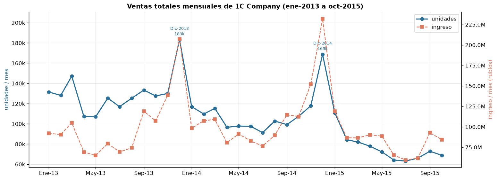
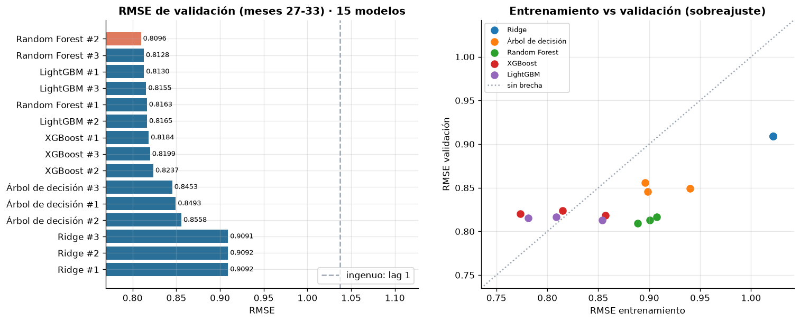

# Predict Future Sales — EDA y Pipeline de Machine Learning

<a target="_blank" href="https://cookiecutter-data-science.drivendata.org/">
    
</a>

Proyectos #1 y #2 del curso **Product Development** (Maestría) sobre el dataset
[Predict Future Sales](https://www.kaggle.com/competitions/competitive-data-science-predict-future-sales/data)
de Kaggle: ventas diarias de la cadena rusa de tiendas **1C Company** (enero 2013 – octubre 2015).

El objetivo de la competencia es **predecir las ventas mensuales (`item_cnt_month`) de cada par
tienda–producto para noviembre de 2015** (`date_block_num = 34`), evaluado con **RMSE**.

| Fase | Contenido | Notebooks |
|---|---|---|
| **Proyecto #1 – EDA** | Estructura, calidad, patrones temporales, ACF/PACF y cobertura del test | `01` |
| **Proyecto #2 – Pipeline ML** | Ingeniería de características, pipeline de sklearn, torneo de 15 modelos e inferencia sobre `test.csv` | `02` a `05` |

> **Uso de IA:** este proyecto se desarrolló con apoyo de Claude Code dentro de VSCode, tal como lo
> permite el enunciado.

---

## Proyecto #1 — Análisis exploratorio (EDA)

### Contenido del análisis

El notebook [`notebooks/01_exploratory_data_analysis.ipynb`](notebooks/01_exploratory_data_analysis.ipynb)
cubre los puntos del enunciado:

| # | Sección | Qué se hace |
|---|---------|-------------|
| 2 | Comprensión inicial | Carga de los 5 archivos, primeras filas, dimensiones, diccionario de columnas, variable objetivo, rango temporal |
| 3 | Validación de estructura | Tipos de datos, conversión de `date` (dd.mm.aaaa → datetime), días sin ventas, consistencia `date_block_num` ↔ fecha, frecuencia de agregación |
| 4 | Faltantes y duplicados | Nulos, precios ≤ 0, cantidades negativas (devoluciones), filas duplicadas, tiendas repetidas en `shops.csv` |
| 5 | Descriptivo general | Estadísticos de `item_price`, `item_cnt_day` e ingresos; distribución por producto/categoría, tienda y periodo |
| 6 | Exploración temporal | Tendencia, estacionalidad, picos/caídas, ciclos por día de la semana y mes del año |
| 7 | Comparativo | Productos y categorías más/menos vendidos, desempeño por tienda, outliers |
| 8 | Visualizaciones clave | Serie de tiempo total, barras por tienda, barras por producto (top N) y categoría, heatmaps |
| 9 | ACF / PACF | Serie total (mensual y diaria), por tienda, por producto y por tienda–producto |
| 10 | Insights y conclusiones | Variables relevantes, patrones para forecasting, cobertura de `test.csv` en el train, calidad del dataset |

### Resultados principales del EDA



**Calidad de los datos**

- 0 valores nulos, integridad referencial completa, calendario sin huecos (1,034 días) y
  `date_block_num` 100% consistente con la fecha.
- Limpieza mínima y justificada (detalle en la sección 4 del notebook):

  | Decisión | Filas |
  |---|---|
  | Duplicados exactos eliminados | 6 |
  | Precio −1 imputado con la mediana producto-tienda-mes | 1 |
  | Transacciones extremas aisladas eliminadas (precio > 100,000; cantidad > 1,000) | 2 |
  | Tiendas duplicadas unificadas (0→57, 1→58, 11→10) | 3 IDs |
  | Devoluciones conservadas, porque el objetivo es la venta neta | 7,356 |

**Patrones**

| Patrón | Hallazgo |
|---|---|
| Tendencia | Unidades **−1.8% por mes**; el ingreso es casi plano porque el precio medio sube de ≈700 a ≈1,200 rublos |
| Estacionalidad anual | **Diciembre +60%** sobre la media mensual; noviembre (mes a predecir) **+9.6%**; abril–julio son los meses más bajos |
| Ciclo semanal | Sábado **+41%**, domingo +18%, lunes −23% (estable en los 3 años) |
| ACF / PACF | El **rezago 1** es significativo en casi todas las series (AR(1)). La serie total mensual diferenciada muestra estacionalidad en el rezago 12; la diaria, ciclo semanal (s = 7). A nivel producto domina el ciclo de vida, no el calendario |
| Concentración | El 20% de los productos genera el 82% de las unidades. Cine lidera en unidades (25%) y Juegos de consola en ingreso (34%) |
| Lanzamientos | Un par tienda–producto vende **1.9×** más en el mes de lanzamiento que 6 meses después |

**Cobertura de `test.csv`** (214,200 pares = 42 tiendas × 5,100 productos)

| Grupo | % de los pares |
|---|---|
| Par con historial en esa tienda | **52.0%** |
| Producto conocido, nunca vendido en esa tienda | 40.8% |
| Producto nuevo (363 productos sin historial) | 7.1% |

Solo el 13.4% de los pares de test vendió algo en octubre 2015: la mayoría de las predicciones
estarán cerca de 0.

---

## Proyecto #2 — Pipeline de Machine Learning

### Notebooks

| Notebook | Contenido | Salida |
|---|---|---|
| [`02_feature_exploration.ipynb`](notebooks/02_feature_exploration.ipynb) | Grid mensual con ceros, selección de *lags* (correlación + prueba empírica), los 6 procesos de ingeniería de características con su criterio, lista final de variables y mapeos | Proceso escrito (sección 4) |
| [`03_feature_creation.ipynb`](notebooks/03_feature_creation.ipynb) | `Pipeline` de sklearn con los 14 pasos, validación (sin NaN, sin fuga de información) | `models/preprocessing_pipeline.pkl` |
| [`04_model_training_n_tunning.ipynb`](notebooks/04_model_training_n_tunning.ipynb) | 5 familias × 3 configuraciones = 15 modelos, validación secuencial, RMSE, análisis del ganador | `models/full_pipeline.pkl` |
| [`05_inference_calculation.ipynb`](notebooks/05_inference_calculation.ipynb) | Inferencia sobre `test.csv` crudo con el pipeline completo, validación del formato | `data/processed/submission.csv` |

### Enfoque: forecasting global con variables exógenas

En lugar de una serie de tiempo por cada par (más de 400 mil series casi vacías) se entrena un
**modelo global sobre rezagos** (tipo *ARX*). Cada fila es *(mes, tienda, producto)*:

- **Parte autorregresiva**: ventas del propio par en los meses `m−1, m−2, m−3, m−6, m−12`.
- **Tienda y producto como variables exógenas**: códigos de tienda y categoría, ciudad, tipo de
  tienda, grupo de categoría, historia agregada del producto, de la categoría, de la tienda y de
  tienda × categoría, precio, y **banderas** `item_is_new` / `pair_is_new` con su antigüedad.
  Esto permite pronosticar el 48% de los pares de `test.csv` que no tienen historia propia.
- **Dataset**: grid mensual tienda × producto activos con ceros en los meses sin ventas
  (10.9 millones de filas, 85% en cero), objetivo recortado a [0, 20].
- **Validación secuencial** (no aleatoria), como pide el enunciado: entrenamiento meses 0–26,
  validación meses 27–33.
- **Sin fuga de información**: cada lag usa solo meses anteriores al mes de la fila (para el mes 34,
  los meses 33, 32, 31…). Se verificó con pruebas automáticas en los notebooks 02 y 03.

### Pipeline de preprocesamiento (14 pasos)

El pipeline recibe **datos crudos** (`date_block_num, shop_id, item_id`, lo mismo que trae
`test.csv`) y genera las 40 variables del modelo. Los transformadores propios están en
[`predict_future_sales/features.py`](predict_future_sales/features.py).

| # | Paso | Operador | Proceso del enunciado |
|---|---|---|---|
| 1 | `history` | `SalesHistoryFeatures` (propio) | lags (par, producto, categoría, tienda, tienda × categoría), precio, antigüedad, banderas, calendario |
| 2–4 | `map_*` | `Mapper` (propio, interfaz del visto en clase) | `shop_id → city`, `shop_id → shop_type`, `item_category_id → category_group` |
| 5 | `drop_keys` | `DropFeatures` | elimina `date_block_num` e `item_id` |
| 6–7 | `missing_indicator`, `num_imputer` | `AddMissingIndicator`, `MeanMedianImputer(median)` | **i. imputación numérica** |
| 8 | `cat_imputer` | `CategoricalImputer("Missing")` | **ii. imputación categórica** |
| 9–10 | `onehot`, `mean_encoder` | `OneHotEncoder`, `MeanEncoder` | **iii. codificación** |
| 11 | `outliers` | `Winsorizer` (percentil 99) | **iv. outliers** |
| 12 | `log` | `LogCpTransformer` (`log(x+1)`) | **v. transformación** |
| 13 | `scaler` | `StandardScaler` | **vi. escalado** |
| 14 | `float32` | `DtypeDowncaster` (propio) | reduce memoria a la mitad |

### Resultados del torneo (RMSE de validación, meses 27–33)

| Familia | Mejor configuración | RMSE validación |
|---|---|---|
| **Random Forest** 🏆 | `n_estimators=50, max_depth=14, min_samples_leaf=20` | **0.8096** |
| LightGBM | `n_estimators=300, num_leaves=31, learning_rate=0.1` | 0.8130 |
| XGBoost | `n_estimators=300, max_depth=6, learning_rate=0.1` | 0.8184 |
| Árbol de decisión | `max_depth=16, min_samples_leaf=200` | 0.8453 |
| Ridge | `alpha=1000` | 0.9091 |
| *Referencia ingenua* | repetir el mes anterior (lag 1) | *1.0373* |



- El ganador mejora en **22%** al pronóstico ingenuo. Las 15 configuraciones están en
  [`reports/model_tournament_results.csv`](reports/model_tournament_results.csv) y el resumen del
  ganador en [`reports/best_model.json`](reports/best_model.json).
- Importancia de variables del ganador: historia propia del par 50%, **producto/categoría 32%,
  tienda 16%** (exógenas), calendario 2%.
- El pipeline completo se re-entrenó con los meses 0–33 antes de predecir noviembre 2015.

### Predicciones (`test.csv`, noviembre 2015)

- `data/processed/submission.csv`: 214,200 filas con `ID, item_cnt_month`, mismo formato que
  `sample_submission.csv`, valores en [0, 20].
- Media predicha 0.30 unidades por par. Total 64,156 unidades, frente a 54,760 reales de los
  mismos pares en octubre 2015; la diferencia la aportan sobre todo los productos nuevos.
- Correlación de 0.998 entre el total real de octubre y el total predicho por tienda.

### Artefactos generados

| Archivo | Descripción |
|---|---|
| `models/preprocessing_pipeline.pkl` | Pipeline de ingeniería de características ajustado (meses 0–26), 18 MB |
| `models/full_pipeline.pkl` | Preprocesamiento + Random Forest ganador re-entrenado con meses 0–33, 25 MB |
| `data/processed/submission.csv` | Predicciones de `test.csv` en formato Kaggle |
| `reports/model_tournament_results.csv` | Tabla de los 15 modelos (RMSE entrenamiento y validación, tiempos) |
| `reports/best_model.json` | Modelo ganador e hiperparámetros |

> Los `.pkl` se cargan con `joblib.load(...)` desde cualquier notebook o script, siempre que el
> paquete `predict_future_sales` esté instalado (`pip install -e .`), porque el pipeline usa sus
> transformadores.

---

## Datos

Los datos **no se versionan** (≈100 MB). Hay que descargarlos manualmente desde Kaggle (requiere
cuenta gratuita):

1. Ir a <https://www.kaggle.com/competitions/competitive-data-science-predict-future-sales/data>.
2. Aceptar las reglas de la competencia y descargar el `.zip`.
3. Descomprimir los archivos en **`data/raw/`**.

Alternativa con la CLI de Kaggle (requiere `~/.kaggle/kaggle.json`):

```bash
kaggle competitions download -c competitive-data-science-predict-future-sales -p data/raw
unzip data/raw/competitive-data-science-predict-future-sales.zip -d data/raw
```

Estructura esperada:

```
data/raw/
├── sales_train.csv          # ventas diarias históricas (≈2.9 M filas)
├── items.csv                # catálogo de productos
├── item_categories.csv      # catálogo de categorías
├── shops.csv                # catálogo de tiendas
├── test.csv                 # pares tienda–producto a predecir (nov 2015)
└── sample_submission.csv    # formato de entrega de Kaggle
```

### Diccionario de datos

| Archivo | Columna | Descripción |
|---------|---------|-------------|
| `sales_train.csv` | `date` | Fecha de la venta (texto `dd.mm.aaaa` en el archivo original) |
| | `date_block_num` | Número de mes consecutivo: 0 = enero 2013, …, 33 = octubre 2015 |
| | `shop_id` | Identificador de la tienda |
| | `item_id` | Identificador del producto |
| | `item_price` | Precio del producto en esa transacción (rublos) |
| | `item_cnt_day` | Unidades vendidas en el día (negativo = devolución) |
| `items.csv` | `item_name` | Nombre del producto (en ruso) |
| | `item_category_id` | Identificador de la categoría del producto |
| `item_categories.csv` | `item_category_name` | Nombre de la categoría (en ruso, formato `Grupo - Subgrupo`) |
| `shops.csv` | `shop_name` | Nombre de la tienda (en ruso, empieza por la ciudad) |
| `test.csv` | `ID` | Identificador de la fila a predecir |

- **Variable objetivo (competencia):** `item_cnt_month` = suma mensual de `item_cnt_day` por par
  tienda–producto (Kaggle la recorta al rango [0, 20]).
- **Variable derivada:** `revenue = item_price × item_cnt_day` (el dataset no trae ventas en dinero).

---

## Entorno de desarrollo

Requisitos: [Anaconda/Miniconda](https://www.anaconda.com/) y `git`.

```bash
# 1. Clonar el repositorio
git clone https://github.com/cesargp45/predict-future-sales.git
cd predict-future-sales

# 2. Crear y activar el entorno conda (Python 3.12 + dependencias + paquete en modo editable)
conda env create -f environment.yml
conda activate predict-future-sales

# 3. Registrar el kernel para Jupyter / VSCode
python -m ipykernel install --user --name predict-future-sales --display-name "Python (predict-future-sales)"

# 4. Colocar los CSV de Kaggle en data/raw/ (ver sección "Datos")

# 5. Abrir los notebooks (en VSCode: seleccionar el kernel "Python (predict-future-sales)")
jupyter lab notebooks/
```

Orden de ejecución: `01` genera `data/processed/monthly_shop_item.csv`, que usan los notebooks
`02` a `05`; `03` genera el pipeline de preprocesamiento que usa `04`, y `04` genera el pipeline
completo que usa `05`. Tiempos aproximados en una laptop de 16 GB de RAM: `02` ≈ 12 min,
`03` ≈ 2 min, `04` ≈ 25 min (15 modelos sobre 9.3 millones de filas), `05` ≈ 1 min. El grid mensual
ocupa varios GB en memoria: se recomiendan **16 GB de RAM**.

Para ejecutar el notebook completo desde la terminal (≈2 minutos; deja los outputs guardados en el
mismo archivo y regenera las figuras de `reports/figures/` y los datasets de `data/interim/` y
`data/processed/`):

```bash
jupyter nbconvert --to notebook --execute --inplace notebooks/01_exploratory_data_analysis.ipynb
```

Para generar solo el dataset de ventas limpio, sin ejecutar el notebook:

```bash
python -m predict_future_sales.dataset           # -> data/interim/sales_clean.csv
```

Scripts del Proyecto #2 (equivalentes a la sección 5 del notebook 04 y al notebook 05):

```bash
python -m predict_future_sales.modeling.train    # re-entrena models/full_pipeline.pkl (meses 0-33)
python -m predict_future_sales.modeling.predict  # -> data/processed/submission.csv
```

También se incluye `requirements.txt` con las versiones exactas instaladas (`pip freeze`) para
quien no use conda: `pip install -r requirements.txt && pip install -e .`

> **Nota (Windows):** `environment.yml` fija `libblas=*=*openblas`. Con la variante MKL por defecto,
> `numpy.linalg` (que usan ACF/PACF y la prueba ADF de `statsmodels`) se cae al abrir el kernel sin
> activar el entorno, porque MKL no encuentra sus DLL. No quitar esa línea.

Comandos útiles del `Makefile` (en Windows requieren `make`, p. ej. vía Git Bash o Chocolatey):

| Comando | Acción |
|---------|--------|
| `make create_environment` | Crea el entorno conda |
| `make requirements` | Actualiza el entorno con `environment.yml` |
| `make data` | Genera `data/interim/sales_clean.csv` desde `data/raw/` |
| `make eda` | Ejecuta el notebook de EDA de punta a punta |
| `make pipeline` | Ejecuta los notebooks 02 a 05 en orden (Proyecto #2) |
| `make train` | Re-entrena el pipeline completo con el modelo ganador |
| `make predict` | Genera `data/processed/submission.csv` |
| `make lint` / `make format` | Revisa / formatea el código con `ruff` |
| `make clean` | Borra archivos `*.pyc` y `__pycache__` |

---

## Organización del proyecto

Estructura generada con la plantilla **Cookiecutter Data Science v2** (`ccds`):

```
├── Makefile               <- Comandos de conveniencia (entorno, lint, formato)
├── README.md              <- Este archivo
├── environment.yml        <- Definición del entorno conda
├── requirements.txt       <- Versiones exactas instaladas (pip freeze)
├── pyproject.toml         <- Metadata del paquete y configuración de ruff
├── data
│   ├── external           <- Datos de terceros (no usado por ahora)
│   ├── interim            <- sales_clean_enriched.csv: ventas limpias + catálogos (generado)
│   ├── processed          <- monthly_shop_item.csv (generado) y submission.csv (predicciones, versionado)
│   └── raw                <- CSV originales de Kaggle (inmutables, no versionados)
├── docs                   <- Documentación adicional
├── models
│   ├── preprocessing_pipeline.pkl   <- Pipeline de ingeniería de características (Proyecto #2)
│   └── full_pipeline.pkl            <- Preprocesamiento + modelo ganador (Proyecto #2)
├── notebooks
│   ├── 01_exploratory_data_analysis.ipynb   <- Proyecto #1: EDA
│   ├── 02_feature_exploration.ipynb         <- Proyecto #2: selección de lags y transformaciones
│   ├── 03_feature_creation.ipynb            <- Proyecto #2: pipeline de preprocesamiento (.pkl)
│   ├── 04_model_training_n_tunning.ipynb    <- Proyecto #2: torneo de 15 modelos (.pkl completo)
│   └── 05_inference_calculation.ipynb       <- Proyecto #2: predicciones sobre test.csv (.csv)
├── references
│   └── diccionario_datos.md   <- Columnas, objetivo y traducción de las 84 categorías y 60 tiendas
├── reports
│   ├── figures            <- Gráficas de los notebooks (prefijo p2_ = Proyecto #2)
│   ├── model_tournament_results.csv   <- Resultados de los 15 modelos
│   ├── best_model.json    <- Modelo ganador e hiperparámetros
│   └── pull_screenshots   <- Screenshots del `git pull` de cada integrante
└── predict_future_sales   <- Paquete Python del proyecto (instalado con `pip install -e .`)
    ├── __init__.py
    ├── config.py          <- Rutas del proyecto (RAW_DATA_DIR, PROCESSED_DATA_DIR, FIGURES_DIR, ...)
    ├── dataset.py         <- Carga, traducción de catálogos y limpieza (`clean_sales`) + CLI
    ├── features.py        <- Grid mensual, SalesHistoryFeatures, Mapper y listas de variables
    ├── plots.py           <- Estilo, guardado de figuras, ACF/PACF y etiquetas en español
    └── modeling
        ├── __init__.py
        ├── predict.py     <- Inferencia sobre test.csv (CLI)
        └── train.py       <- Re-entrenamiento del pipeline completo (CLI)
```

> Los nombres de los notebooks siguen lo que piden los enunciados, en lugar de la convención por
> defecto de CCDS (`1.0-<iniciales>-<descripcion>`).

---

## Entregables

Repositorio: <https://github.com/cesargp45/predict-future-sales>

**Proyecto #1 – EDA**

1. Repositorio de GitHub con la estructura de Cookiecutter.
2. Notebook `notebooks/01_exploratory_data_analysis.ipynb` ejecutado, con gráficas e
   interpretaciones escritas.
3. Screenshots del `git pull` de cada integrante del equipo (en `reports/pull_screenshots/`).

**Proyecto #2 – Pipeline de Machine Learning**

1. Repositorio actualizado con los notebooks `02` a `05` ejecutados, con sus explicaciones escritas.
2. Pipeline de ingeniería de características: [`models/preprocessing_pipeline.pkl`](models/preprocessing_pipeline.pkl).
3. Pipeline completo (preprocesamiento + modelo ganador): [`models/full_pipeline.pkl`](models/full_pipeline.pkl).
4. Predicciones sobre el dataset de testing: [`data/processed/submission.csv`](data/processed/submission.csv).

## Equipo

| Integrante | Usuario GitHub | Screenshot del pull |
|------------|----------------|---------------------|
| César García | [@cesargp45](https://github.com/cesargp45) | [Pull_Cesar.png](reports/pull_screenshots/Pull_Cesar.png) |
| Sergio Ruano | [@25002706-cloud](https://github.com/25002706-cloud) | [Pull_Sergio.jpg](reports/pull_screenshots/Pull_Sergio.jpg) |
| Dorotthy Estrada | [@dorotthyestrada](https://github.com/dorotthyestrada) | [Pull_Dorotthy.jpg](reports/pull_screenshots/Pull_Dorotthy.jpg) |
