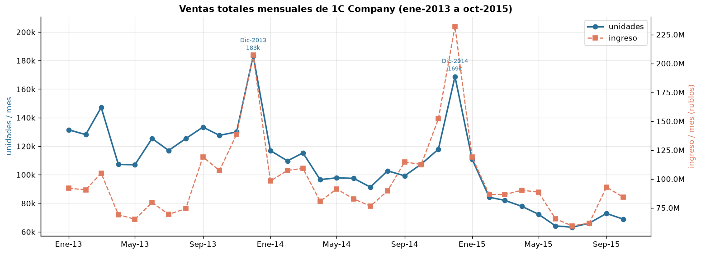

# Predict Future Sales — Exploratory Data Analysis (EDA)

<a target="_blank" href="https://cookiecutter-data-science.drivendata.org/">
    
</a>

Proyecto #1 del curso **Product Development** (Maestría). Análisis exploratorio del dataset
[Predict Future Sales](https://www.kaggle.com/competitions/competitive-data-science-predict-future-sales/data)
de Kaggle: ventas diarias de la cadena rusa de tiendas **1C Company** (enero 2013 – octubre 2015).

El objetivo final de la competencia es **predecir las ventas mensuales (`item_cnt_month`) de cada
par tienda–producto para noviembre de 2015**. Este EDA prepara el terreno para esa etapa de
*forecasting*: entender la estructura de los datos, su calidad, sus patrones temporales y qué
información existe (o no) para los pares que hay que predecir.

> **Uso de IA:** este proyecto se desarrolló con apoyo de Claude Code dentro de VSCode, tal como lo
> permite el enunciado.

---

## Contenido del análisis

El notebook [`notebooks/01_exploratory_data_analysis.ipynb`](notebooks/01_exploratory_data_analysis.ipynb)
cubre los puntos del enunciado:

| # | Sección | Qué se hace |
|---|---------|-------------|
| 2 | Comprensión inicial | Carga de los 5 archivos, primeras filas, dimensiones, diccionario de columnas, variable objetivo, rango temporal |
| 3 | Validación de estructura | Tipos de datos, conversión de `date` (dd.mm.aaaa → datetime), días sin ventas, consistencia `date_block_num` ↔ fecha, frecuencia de agregación |
| 4 | Faltantes y duplicados | Nulos, precios ≤ 0, cantidades negativas (devoluciones), filas duplicadas, tiendas repetidas en `shops.csv` |
| 5 | Descriptivo general | Estadísticos de `item_price`, `item_cnt_day` e ingresos; distribución por producto/categoría, tienda y periodo |
| 6 | Exploración temporal | Tendencia, estacionalidad, picos/caídas, ciclos por día de la semana y mes del año |
| 7 | Comparativo | Productos y categorías más/menos vendidos, desempeño por tienda, outliers |
| 8 | Visualizaciones clave | Serie de tiempo total, barras por tienda, barras por producto (top N) y categoría, heatmaps |
| 9 | ACF / PACF | Serie total (mensual y diaria), por tienda, por producto y por tienda–producto |
| 10 | Insights y conclusiones | Variables relevantes, patrones para forecasting, cobertura de `test.csv` en el train, calidad del dataset |

## Resultados principales



**Calidad de los datos**

- 0 valores nulos, integridad referencial completa, calendario sin huecos (1,034 días) y
  `date_block_num` 100% consistente con la fecha.
- Limpieza mínima y justificada (detalle en la sección 4 del notebook):

  | Decisión | Filas |
  |---|---|
  | Duplicados exactos eliminados | 6 |
  | Precio −1 imputado con la mediana producto-tienda-mes | 1 |
  | Transacciones extremas aisladas eliminadas (precio > 100,000; cantidad > 1,000) | 2 |
  | Tiendas duplicadas unificadas (0→57, 1→58, 11→10) | 3 IDs |
  | Devoluciones conservadas, porque el objetivo es la venta neta | 7,356 |

**Patrones**

| Patrón | Hallazgo |
|---|---|
| Tendencia | Unidades **−1.8% por mes**; el ingreso es casi plano porque el precio medio sube de ≈700 a ≈1,200 rublos |
| Estacionalidad anual | **Diciembre +60%** sobre la media mensual; noviembre (mes a predecir) **+9.6%**; abril–julio son los meses más bajos |
| Ciclo semanal | Sábado **+41%**, domingo +18%, lunes −23% (estable en los 3 años) |
| ACF / PACF | El **rezago 1** es significativo en casi todas las series (AR(1)). La serie total mensual diferenciada muestra estacionalidad en el rezago 12; la diaria, ciclo semanal (s = 7). A nivel producto domina el ciclo de vida, no el calendario |
| Concentración | El 20% de los productos genera el 82% de las unidades. Cine lidera en unidades (25%) y Juegos de consola en ingreso (34%) |
| Lanzamientos | Un par tienda–producto vende **1.9×** más en el mes de lanzamiento que 6 meses después |

**Cobertura de `test.csv`** (214,200 pares = 42 tiendas × 5,100 productos)

| Grupo | % de los pares |
|---|---|
| Par con historial en esa tienda | **52.0%** |
| Producto conocido, nunca vendido en esa tienda | 40.8% |
| Producto nuevo (363 productos sin historial) | 7.1% |

Solo el 13.4% de los pares de test vendió algo en octubre 2015: la mayoría de las predicciones
estarán cerca de 0.

---

## Datos

Los datos **no se versionan** (≈100 MB). Hay que descargarlos manualmente desde Kaggle (requiere
cuenta gratuita):

1. Ir a <https://www.kaggle.com/competitions/competitive-data-science-predict-future-sales/data>.
2. Aceptar las reglas de la competencia y descargar el `.zip`.
3. Descomprimir los archivos en **`data/raw/`**.

Alternativa con la CLI de Kaggle (requiere `~/.kaggle/kaggle.json`):

```bash
kaggle competitions download -c competitive-data-science-predict-future-sales -p data/raw
unzip data/raw/competitive-data-science-predict-future-sales.zip -d data/raw
```

Estructura esperada:

```
data/raw/
├── sales_train.csv          # ventas diarias históricas (≈2.9 M filas)
├── items.csv                # catálogo de productos
├── item_categories.csv      # catálogo de categorías
├── shops.csv                # catálogo de tiendas
├── test.csv                 # pares tienda–producto a predecir (nov 2015)
└── sample_submission.csv    # formato de entrega de Kaggle
```

### Diccionario de datos

| Archivo | Columna | Descripción |
|---------|---------|-------------|
| `sales_train.csv` | `date` | Fecha de la venta (texto `dd.mm.aaaa` en el archivo original) |
| | `date_block_num` | Número de mes consecutivo: 0 = enero 2013, …, 33 = octubre 2015 |
| | `shop_id` | Identificador de la tienda |
| | `item_id` | Identificador del producto |
| | `item_price` | Precio del producto en esa transacción (rublos) |
| | `item_cnt_day` | Unidades vendidas en el día (negativo = devolución) |
| `items.csv` | `item_name` | Nombre del producto (en ruso) |
| | `item_category_id` | Identificador de la categoría del producto |
| `item_categories.csv` | `item_category_name` | Nombre de la categoría (en ruso, formato `Grupo - Subgrupo`) |
| `shops.csv` | `shop_name` | Nombre de la tienda (en ruso, empieza por la ciudad) |
| `test.csv` | `ID` | Identificador de la fila a predecir |

- **Variable objetivo (competencia):** `item_cnt_month` = suma mensual de `item_cnt_day` por par
  tienda–producto (Kaggle la recorta al rango [0, 20]).
- **Variable derivada:** `revenue = item_price × item_cnt_day` (el dataset no trae ventas en dinero).

---

## Entorno de desarrollo

Requisitos: [Anaconda/Miniconda](https://www.anaconda.com/) y `git`.

```bash
# 1. Clonar el repositorio
git clone https://github.com/cesargp45/predict-future-sales.git
cd predict-future-sales

# 2. Crear y activar el entorno conda (Python 3.12 + dependencias + paquete en modo editable)
conda env create -f environment.yml
conda activate predict-future-sales

# 3. Registrar el kernel para Jupyter / VSCode
python -m ipykernel install --user --name predict-future-sales --display-name "Python (predict-future-sales)"

# 4. Colocar los CSV de Kaggle en data/raw/ (ver sección "Datos")

# 5. Abrir el notebook (en VSCode: seleccionar el kernel "Python (predict-future-sales)")
jupyter lab notebooks/01_exploratory_data_analysis.ipynb
```

Para ejecutar el notebook completo desde la terminal (≈2 minutos; deja los outputs guardados en el
mismo archivo y regenera las figuras de `reports/figures/` y los datasets de `data/interim/` y
`data/processed/`):

```bash
jupyter nbconvert --to notebook --execute --inplace notebooks/01_exploratory_data_analysis.ipynb
```

Para generar solo el dataset de ventas limpio, sin ejecutar el notebook:

```bash
python -m predict_future_sales.dataset        # -> data/interim/sales_clean.csv
```

También se incluye `requirements.txt` con las versiones exactas instaladas (`pip freeze`) para
quien no use conda: `pip install -r requirements.txt && pip install -e .`

> **Nota (Windows):** `environment.yml` fija `libblas=*=*openblas`. Con la variante MKL por defecto,
> `numpy.linalg` (que usan ACF/PACF y la prueba ADF de `statsmodels`) se cae al abrir el kernel sin
> activar el entorno, porque MKL no encuentra sus DLL. No quitar esa línea.

Comandos útiles del `Makefile` (en Windows requieren `make`, p. ej. vía Git Bash o Chocolatey):

| Comando | Acción |
|---------|--------|
| `make create_environment` | Crea el entorno conda |
| `make requirements` | Actualiza el entorno con `environment.yml` |
| `make data` | Genera `data/interim/sales_clean.csv` desde `data/raw/` |
| `make eda` | Ejecuta el notebook de EDA de punta a punta |
| `make lint` / `make format` | Revisa / formatea el código con `ruff` |
| `make clean` | Borra archivos `*.pyc` y `__pycache__` |

---

## Organización del proyecto

Estructura generada con la plantilla **Cookiecutter Data Science v2** (`ccds`):

```
├── Makefile               <- Comandos de conveniencia (entorno, lint, formato)
├── README.md              <- Este archivo
├── environment.yml        <- Definición del entorno conda
├── requirements.txt       <- Versiones exactas instaladas (pip freeze)
├── pyproject.toml         <- Metadata del paquete y configuración de ruff
├── data
│   ├── external           <- Datos de terceros (no usado por ahora)
│   ├── interim            <- sales_clean_enriched.csv: ventas limpias + catálogos (generado)
│   ├── processed          <- monthly_shop_item.csv: objetivo mensual por par (generado)
│   └── raw                <- CSV originales de Kaggle (inmutables, no versionados)
├── docs                   <- Documentación adicional
├── models                 <- Modelos serializados (etapas futuras)
├── notebooks
│   └── 01_exploratory_data_analysis.ipynb   <- EDA (entregable principal)
├── references
│   └── diccionario_datos.md   <- Columnas, objetivo y traducción de las 84 categorías y 60 tiendas
├── reports
│   ├── figures            <- 27 gráficas generadas por el notebook
│   └── pull_screenshots   <- Screenshots del `git pull` de cada integrante
└── predict_future_sales   <- Paquete Python del proyecto (instalado con `pip install -e .`)
    ├── __init__.py
    ├── config.py          <- Rutas del proyecto (RAW_DATA_DIR, PROCESSED_DATA_DIR, FIGURES_DIR, ...)
    ├── dataset.py         <- Carga, traducción de catálogos y limpieza (`clean_sales`) + CLI
    ├── features.py        <- Construcción de variables (etapas futuras)
    ├── plots.py           <- Estilo, guardado de figuras, ACF/PACF y etiquetas en español
    └── modeling
        ├── __init__.py
        ├── predict.py     <- Inferencia (etapas futuras)
        └── train.py       <- Entrenamiento (etapas futuras)
```

> El nombre del notebook (`01_exploratory_data_analysis.ipynb`) sigue lo que pide el enunciado,
> en lugar de la convención por defecto de CCDS (`1.0-<iniciales>-<descripcion>`).

---

## Entregables

1. Enlace a este repositorio de GitHub con la estructura de Cookiecutter:
   <https://github.com/cesargp45/predict-future-sales>
2. Notebook `notebooks/01_exploratory_data_analysis.ipynb` ejecutado, con gráficas e
   interpretaciones escritas.
3. Screenshots del `git pull` de cada integrante del equipo (en `reports/pull_screenshots/`).

## Equipo

| Integrante | Usuario GitHub |
|------------|----------------|
| César García | [@cesargp45](https://github.com/cesargp45) |
| Sergio Ruano | _(pendiente)_ |
| Dorotthy Estrada | _(pendiente)_ |
